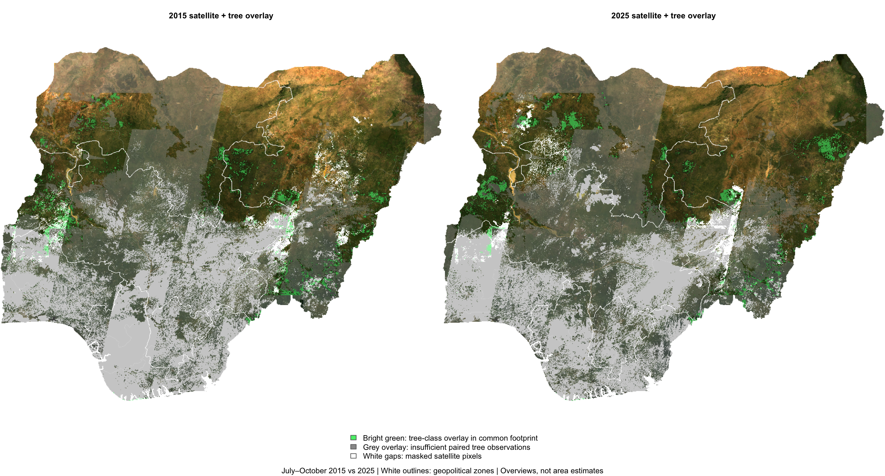
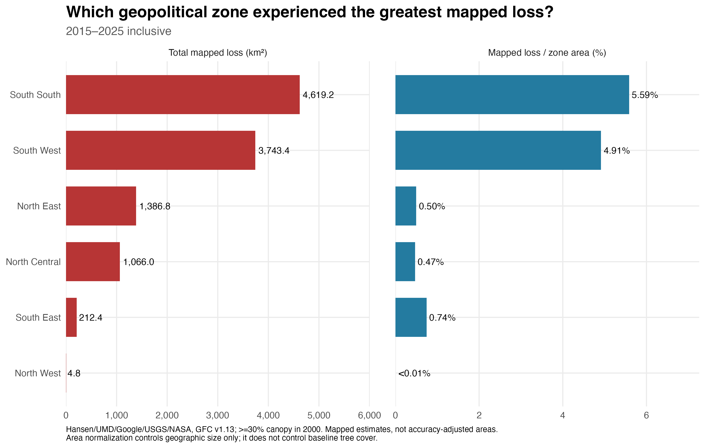
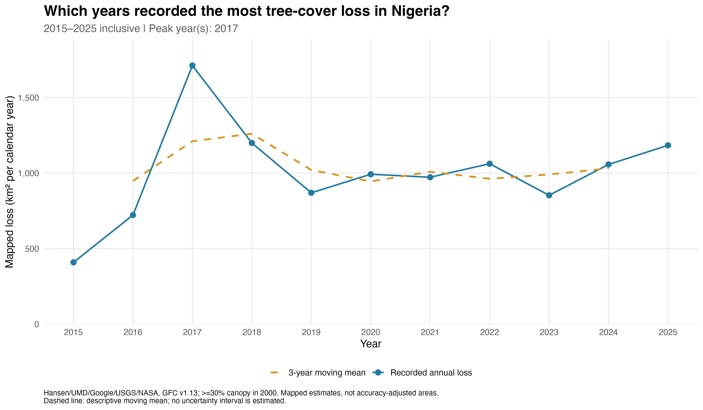
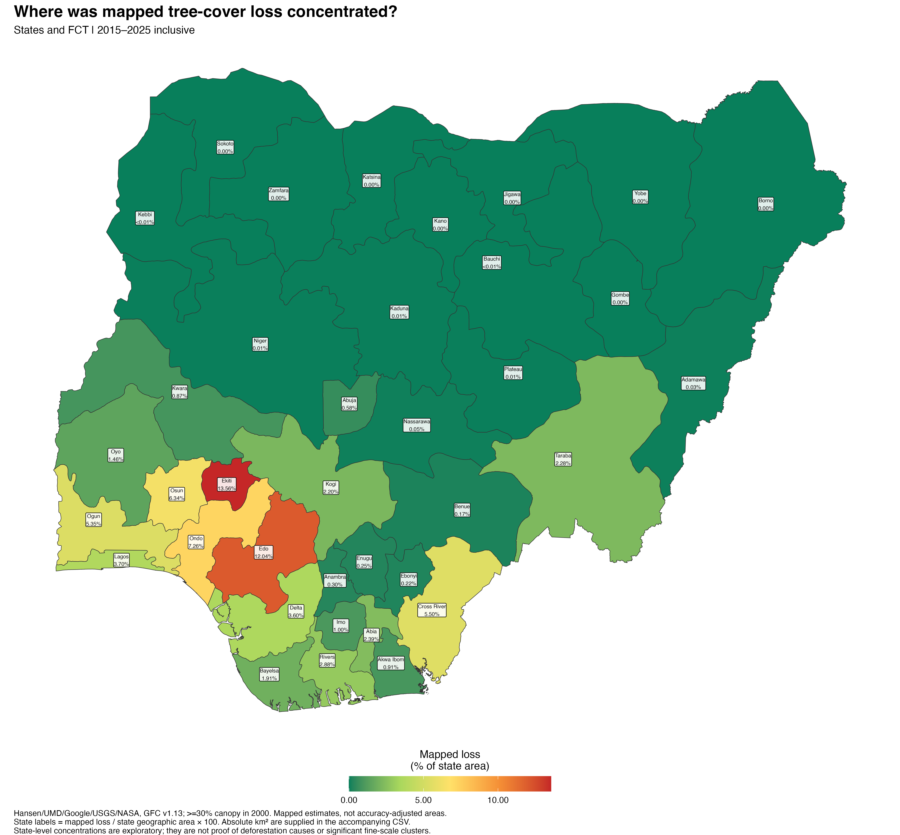
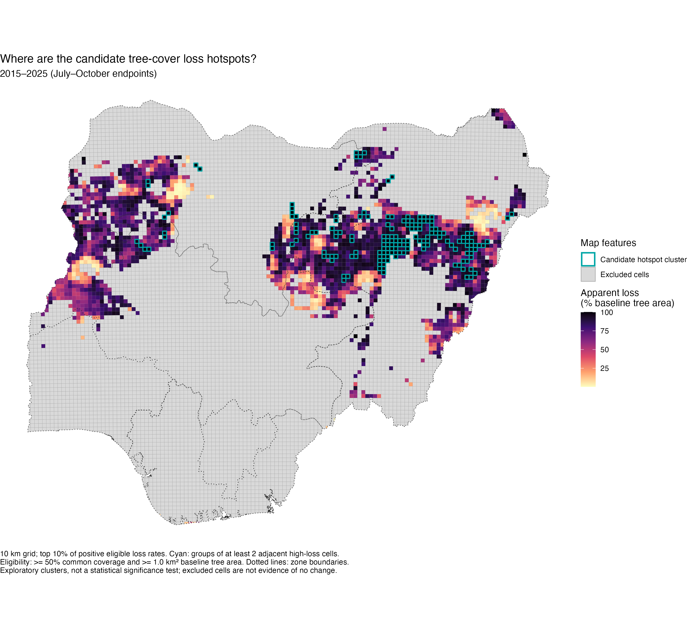

# Nigeria Tree-Cover Change Atlas | 2015–2025

Satellite comparison, annual mapped gross loss and spatial concentrations across Nigeria's six geopolitical zones. R scripts, PNG figures, processed CSV/GeoJSON exports and a source-backed interactive dashboard are included.

## Explore the figures

### 1. Satellite comparison



July–October endpoint composites show tree-class overlays and observation gaps. They are visual context, not a national loss estimate. Green is tree class, not necessarily intact natural forest; grey indicates insufficient paired predictions and white indicates masked RGB pixels.

### 2. Which zone experienced the greatest mapped loss?



Under the Hansen year-2000 canopy ≥30% definition, **South South** has the largest 2015–2025 mapped gross loss: **4,619.2 km²**, or **5.59% of its geographic area**. South West follows at **3,743.4 km²** and **4.91%**. Size adjustment changes some other ranks: South East ranks above both northern central/eastern zones by geographic percentage.

### 3. When did the greatest losses occur?



**2017** is the peak calendar year: **1,711.7 km²** of mapped gross loss. This sums eleven annual observations, 2015 through 2025 inclusive. The dashed curve is a descriptive three-year mean, not an uncertainty interval.

### 4. Where are loss concentrations?



The state map reports cumulative mapped loss divided by full geographic state/FCT area. It is an exploratory concentration map, not a formal hotspot-significance test. [Absolute and relative state values](data/hansen/state_totals_and_size_adjustment.csv) accompany it.



The separate Dynamic World grid map outlines adjacent high-loss cells within an eligible observation footprint. It does not support conclusions for excluded cells or prove agricultural/urban causes.

## Dashboard

[Download the portable dashboard HTML](dashboard-preview/Nigeria_Tree_Cover_Atlas.html) using GitHub's **Download raw file**, then open it in your browser. GitHub's code viewer does not execute HTML. The file includes its reviewed data and runs offline; it is not a public hosted website.

Three views keep the measurements separate:

- **Satellite comparison:** 2015/2025 imagery, interactive zone map with pointer/keyboard values, endpoint change and candidate grid clusters.
- **Annual gross loss:** national annual trend, absolute and size-adjusted regional rankings, state/FCT concentrations and searchable measurements.
- **Coverage & sensitivity:** paired observation coverage, a zone selector, threshold-sensitivity lines and the exact sampled counts.

Dashboard source is in [dashboard](dashboard/); reviewed rows and provenance are in `dashboard/src/data.json`. The compiled offline file is a distribution artifact. The dashboard uses the supplied Data app runtime, keeping source inspection, chart editing, themes, export and presentation controls.

## Coverage changes the interpretation

| Zone | Paired footprint / zone area |
|---|---:|
| North East | 69.36% |
| North West | 43.43% |
| North Central | 21.66% |
| South West | 2.41% |
| South South | 0.28% |
| South East | 0.00% |

Apparent endpoint change is `100 × (loss + gain) / common-observed area`. South West's **23.42%** and South South's **21.50%** refer only to their small observed footprints. They do **not** establish which entire zone changed most. South East has no estimable endpoint rate; zero exported area there means no paired footprint, not proof of no change.

The 1,200-point sensitivity audit tests nine settings. At the main settings, paired sample sizes are only five points in South West, two in South South and zero in South East. Full-area threshold robustness and independent accuracy validation remain open. [Validation and limitations](validation/README.md).

Hansen gross loss and Dynamic World endpoint loss/gain are different measurements. **Do not add them together or treat either as net permanent deforestation.** Geographic-area adjustment controls size, not baseline tree cover.

## Run in R

Open `NigeriaTreeCoverAtlas.Rproj` in RStudio. The project directory must be your working directory. Run:

```r
source('R/Install_Packages.R')  # once; restart R if prompted
source('R/Nigeria_Tree_Cover_ALL_IN_ONE.R')  # defaults to results; uses saved exports
source('R/Audit_Coverage_And_Sensitivity.R') # uses saved point sample offline
source('R/Validate_Exports.R')
```

The **complete self-contained Dynamic World script** has four modes. At its beginning, set `MODE <- "maps"` for satellite previews, `"exports"` for new Earth Engine jobs, `"status"` for job status or `"results"` for saved-data plots. Run the entire script. Results mode needs no Earth Engine connection. Cloud modes require your Earth Engine account and an enabled project; optionally set `Sys.setenv(EE_PROJECT='your-project-id')`. No credentials are stored here.

For a fresh local Hansen calculation:

```r
source('R/Hansen_Annual_Loss_2015_2025.R')
```

This self-contained script downloads twelve official raster tiles (~1.4 GB) if absent, builds VRT mosaics and calculates annual cell-area totals in R. Allow several GB of free disk/R working space and processing time. Set `HANSEN_DATA_ROOT` to reuse a folder with `data/raw/hansen` and `data/derived` before running. Raw rasters and machine-specific VRTs are excluded from Git. State geometry is supplied, so the normal local workflow needs no Earth Engine job.

Both scripts copy their processed tables to `data`. After both analyses, run `source('R/Build_Dashboard_Data.R')`. See [dashboard build instructions](dashboard/README_ATLAS.md).

## Files and sources

- [R scripts](R/) — complete endpoint and annual-loss workflows, package setup, audit, validation and dashboard-data update.
- [Processed data](data/) — zone, grid, state and annual tables; corrected WGS84 grid and hotspot GeoJSONs.
- [Figures](figures/) — separate PNG outputs with legends.
- [Validation](validation/) — coverage, sensitivity sample/scenarios, reconciliation and checksums.
- [Earth Engine scripts](earth-engine/) — retained original cloud dashboard and satellite scripts.
- [Sources, licenses and coordinate-system notes](DATA_SOURCES.md).

Primary sources: [Dynamic World](https://developers.google.com/earth-engine/datasets/catalog/GOOGLE_DYNAMICWORLD_V1), [Hansen GFC v1.13](https://developers.google.com/earth-engine/datasets/catalog/UMD_hansen_global_forest_change_2025_v1_13), [Landsat 8](https://developers.google.com/earth-engine/datasets/catalog/LANDSAT_LC08_C02_T1_L2), and [FAO GAUL 2015](https://developers.google.com/earth-engine/datasets/catalog/FAO_GAUL_2015_level1). Boundary data retain FAO's separate noncommercial terms.

## Delivery status

- [x] Build satellite comparison and annual-loss R scripts.
- [x] Generate R maps and interpret supported descriptive results.
- [x] Include complete self-contained scripts.
- [x] Include PNG figures and processed CSV/GeoJSON exports.
- [x] Audit coverage and run sample-based classification sensitivity.
- [x] Build a visual-first interactive dashboard with inspectable sources.
- [ ] Full-area threshold/observation sensitivity at 10 m.
- [ ] Independent reference-label accuracy assessment and area-adjusted uncertainty.

**Status: exploratory analysis, share with the stated caveats.** The Earth Engine project reports restricted mode after exceeding its noncommercial compute quota; completed exports and local Hansen calculations remain usable.
